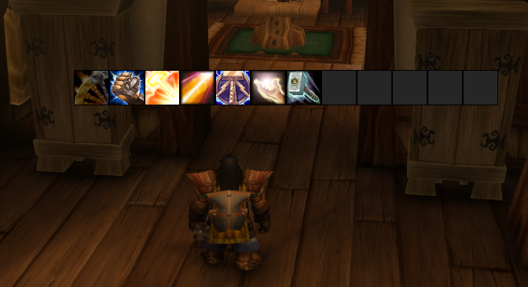
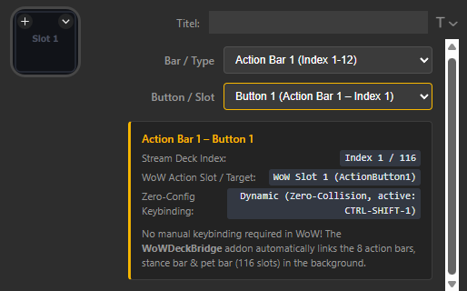
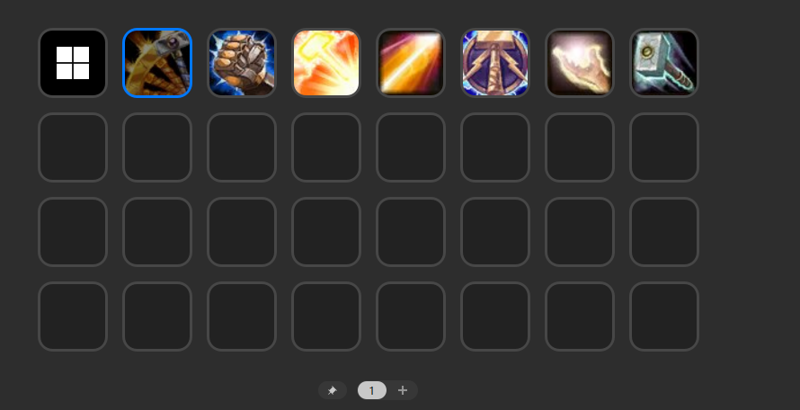

# WoWDeck (Stream Deck Plugin + WoW Addon)

**Author:** Behmen | **Current Release:** `v1.0.1` (Addon `v1.0.1` / Plugin `v1.0.1`) | **Target Client:** World of Warcraft: Classic Forever (Build `16001`)

**WoWDeck** verbindet **World of Warcraft** in Echtzeit mit deinem **Elgato Stream Deck**. Es überträgt Aktionsleisten, Icons, Cooldowns (inkl. originalem Radial-Sweep), Reichweiten- und Mana-Status sowie Stapelzahlen ohne manuelle Tastenkonfiguration direkt auf die Tasten deines Stream Decks.

*Aktuell unterstützte Versionen: **WoW: Classic Forever (Build 16001)** (weitere Versionen folgen).*

> **Wichtig – Beide Komponenten erforderlich:**
> 1. **Elgato Stream Deck Plugin** (`com.behmen.wowdeck_v1.0.1.streamDeckPlugin`) – [GitHub Releases](https://github.com/Behmen-hub/WoWDeck/releases/latest)
> 2. **WoW Ingame-Addon** (`WoWDeckBridgeForever_v1.0.1.zip`) – [CurseForge](https://www.curseforge.com/wow/addons/wowdeckbridge) oder [GitHub Releases](https://github.com/Behmen-hub/WoWDeck/releases/latest)

---

## Wie funktioniert das?
1. **Ingame-Telemetrie:** Das WoW-Addon spiegelt den Zustand aller 116 Aktionsleisten-Slots (Icons, Cooldowns, Reichweite) über einen winzigen, unauffälligen `234×1`-Pixel-Streifen in der oberen linken Bildschirmecke (`0,0`).
2. **Echtzeit-Anzeige:** Das Stream Deck Plugin liest diesen Datenstreifen in Echtzeit aus und visualisiert alles flüssig auf deinen Tasten – inklusive radialem Cooldown-Sweep.
3. **Null Konfiguration:** Keine Makros oder manuelle Tastenbelegungen nötig. Das Addon sucht sich beim Login automatisch freie Tasten aus einem sicheren Pool. Einfach die Aktion im Stream Deck auf eine Taste ziehen und losspielen.

---

## Features
* **Zero-Config Dynamic Keybindings:** Findet beim Login automatisch freie Tastenkombinationen aus einem Pool von 174 Bindings, ohne bestehende Tasten (`W, A, S, D, Q, E, R` etc.) zu überschreiben.
* **116 unterstützte Slots (auch bei ausgeblendeten Leisten):**
  * **Index 1–96:** Aktionsleisten 1–8 (inkl. automatischem Paging bei Haltungs-/Gestaltwechsel auf Leiste 1)
  * **Index 97–106:** Haltungs-/Gestaltleiste (Stance Bar 1–10)
  * **Index 107–116:** Begleiterleiste (Pet Bar 1–10)
* **Originalgetreue Optik & Smooth Radial Cooldown:** Flüssiger, halbtransparenter Cooldown-Sweep im Uhrzeigersinn mit rein weißen Zahlen (Sekundenanzeige bis `120s`, danach Minutenanzeige wie `2m`, `3m` bis `19m`), Out-of-Range- und Out-of-Mana-Indikatoren.
* **Multi-Auflösungs-Support:** Automatische 1:1 Pixel-Skalierung für alle nativen Bildschirmauflösungen (`1080p`, `1440p`, `4K`, `8K` bei `100 %` Render-Scale).
* **100 % Combat-Lockdown- & Secret-Value-Safe:** Speziell für die Forever/Midnight-Engine (Build `16001`) angepasst – keine Lua-Fehler im Kampf.
* **100 % ToS-konform:** Liest ausschließlich den `234×1` Pixel großen optischen Telemetrie-Streifen an `(0,0)` aus und sendet pro physischem Tastendruck exakt einen einzelnen Hardware-Keystroke (`1-Click = 1-Action`).

---

## Screenshots

---

## Installation & Voraussetzungen

> **Hinweis für Nutzer:** Lade **nicht** den Quellcode aus diesem Repository herunter, sondern nutze ausschließlich die fertigen Installationspakete unter [GitHub Releases](https://github.com/Behmen-hub/WoWDeck/releases/latest).

### Schritt 1: WoW-Addon installieren (`WoWDeckBridgeForever`)
1. Lade das Addon über die [CurseForge App](https://www.curseforge.com/wow/addons/wowdeckbridge) oder als `WoWDeckBridgeForever_v1.0.1.zip` aus den [GitHub Releases](https://github.com/Behmen-hub/WoWDeck/releases/latest) herunter.
2. Entpacke den Ordner `WoWDeckBridgeForever` nach:
   `...\World of Warcraft\_forever_\Interface\AddOns\WoWDeckBridgeForever`

### Schritt 2: Stream Deck Plugin installieren (`com.behmen.wowdeck`)
1. Lade `com.behmen.wowdeck_v1.0.1.streamDeckPlugin` aus den [GitHub Releases](https://github.com/Behmen-hub/WoWDeck/releases/latest) herunter.
2. Doppelklicke auf die Datei – die Elgato Stream Deck Software installiert das Plugin automatisch.
3. Ziehe die Aktion **"WoW Action Slot"** aus der Kategorie **WoWDeck** auf eine Taste und wähle Leiste + Slot (`1–116`).

### Anzeige-Voraussetzungen
* **Anzeigemodus:** Zwingend **Vollbildmodus** oder **Fenstermodus (Maximiert) / Randlos**. Ein klassischer, nicht-maximierter Fenstermodus (mit Windows-Titelleiste und Rahmen) wird nicht unterstützt.
* **Native 1:1 Auflösung (`100 %` Render-Skalierung):** Die Spielauflösung muss 1:1 der nativen Monitorauflösung entsprechen (`1080p`, `1440p`, `4K`, `8K` ohne Up-/Downscaling).
* **Keine Overlays auf `(0,0)`:** Die obere linke Ecke darf nicht durch Overlays (Discord, GeForce Experience, FPS-Counter) oder Windows Auto-HDR / Farbfilter verdeckt oder verfälscht werden.

---

## Hinweis zu Windows SmartScreen / Antivirus
Das Stream Deck Plugin nutzt im Hintergrund einen leichtgewichtigen, nativen Windows-Helper (C#), um den `234×1`-Pixel-Streifen verzögerungsfrei per GDI auszulesen und den Tastendruck an das WoW-Fenster zu senden.
* Da die ausführbare Datei nicht mit einem kostenpflichtigen Microsoft-EV-Zertifikat signiert ist, kann Windows SmartScreen beim ersten Start eine Warnung anzeigen (*„Der PC wurde durch Windows geschützt“* → *Weitere Informationen* → *Trotzdem ausführen*).
* **100 % Open Source:** Kein Memory Reading und keine Injection. Der vollständige Quellcode (`src/`, `com.behmen.wowdeck.sdPlugin/`, `WoWDeckBridgeForever/`) ist in diesem Repository offen einsehbar.

---

## Repository-Struktur (Für Entwickler)
* `WoWDeckBridgeForever/` – Lua-Ingame-Addon für WoW: Classic Forever (Build `16001`).
* `src/` – TypeScript-Quellcode des Stream Deck Plugins & C#-Helper-Quellcode.
* `com.behmen.wowdeck.sdPlugin/` – Stream Deck Plugin-Struktur, Manifest, Property Inspector & Assets.
* `tests/` – Unit- & Integrationstests.
* `package.json` / `tsconfig.json` – Build-Konfiguration (`npm install && npm run build`).

---

## Changelog
* **v1.0.1** *(Addon v1.0.1 | Plugin v1.0.1)*
  * **1:1 Multi-Resolution Scaling:** Unterstützung für alle nativen Bildschirmauflösungen (`1080p`, `1440p`, `4K`, `8K` bei `100 %` Render-Scale).
  * **Auto-Recovery bei Auflösungswechsel:** Selbstheilende Neuskalierung im Addon ohne Spielneustart.
  * **Erweiterte Cooldown-Anzeige (`> 240s`):** Unterstützung für lange Cooldowns bis 19 Minuten inkl. Minutenanzeige (`2m`, `3m` etc. ab `120s`).
  * **Property Inspector UI:** Klarere Beschriftung der WoW-Aktionsleisten im Stream Deck Dropdown.
* **v1.0.0** *(Addon v1.0.0 | Plugin v1.0.0)*
  * Initial Release für WoW: Classic Forever (Build `16001`).

---

## English Summary & Installation

**WoWDeck** by **Behmen** connects **World of Warcraft: Classic Forever (Build 16001)** with your **Elgato Stream Deck**. It provides live action bar icons, smooth radial cooldown sweeps, mana/range indicators, and automatic zero-collision keybinding allocation across 116 slots (Action Bars 1–8, Stance Bar, Pet Bar).

### Installation & Display Requirements (Both Components Required)
1. **WoW Addon (`WoWDeckBridgeForever`):** Download via [CurseForge](https://www.curseforge.com/wow/addons/wowdeckbridge) or [GitHub Releases](https://github.com/Behmen-hub/WoWDeck/releases/latest) and extract to `_forever_\Interface\AddOns\WoWDeckBridgeForever`.
   * **Display Requirements:** Must run in **Fullscreen** or **Windowed (Maximized) / Borderless** mode at your monitor's **native 1:1 resolution (`100%` Render Scale)**. Classic floating windowed mode and non-native render scaling are not supported. Ensure no third-party overlays cover the top-left `(0,0)` corner.
2. **Stream Deck Plugin (`com.behmen.wowdeck_v1.0.1.streamDeckPlugin`):** Download from [GitHub Releases](https://github.com/Behmen-hub/WoWDeck/releases/latest) (do not download the raw source repository) and double-click to install into the Elgato Stream Deck software.
3. **Windows SmartScreen Note:** The plugin uses a lightweight C# GDI screen-reader and keystroke helper. Because it is not commercially code-signed, Windows SmartScreen may prompt a warning on first launch. The entire source code (`src/`) is publicly available in this repository.
