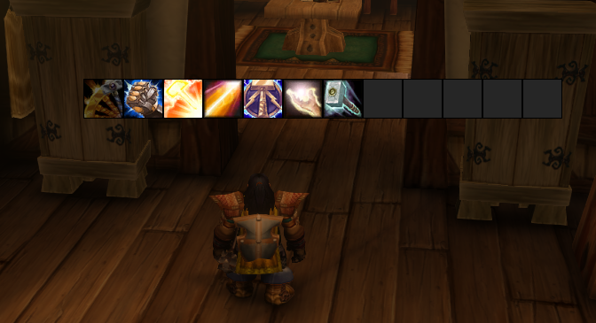
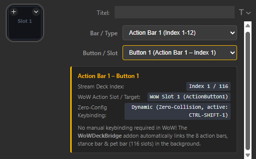
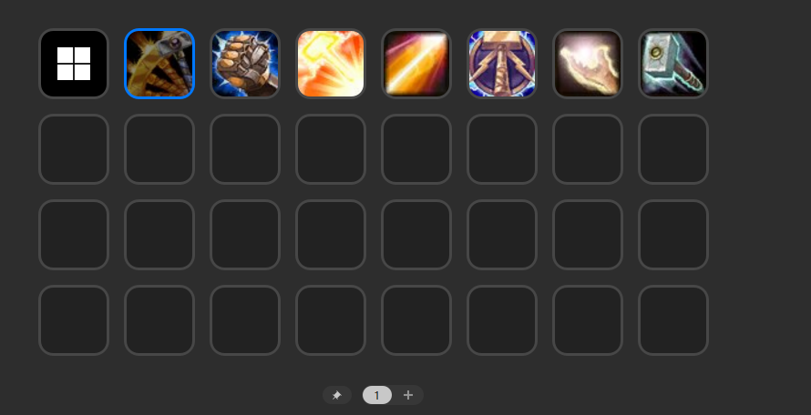

# WoWDeck (Stream Deck Plugin + WoW Addon)
**Author:** Behmen  
**Current Release:** v1.0.1 (Addon v1.0.1 | Plugin v1.0.1)  
**Target Client:** World of Warcraft: Classic Forever (Build 16001)

**WoWDeck** verbindet **World of Warcraft** in Echtzeit mit deinem **Elgato Stream Deck**. Es überträgt deine Aktionsleisten, Icons, Cooldowns (inkl. originalem Radial-Sweep), Reichweiten- und Mana-Status sowie Stapelzahlen ohne manuelle Tastenkonfiguration direkt auf die Tasten deines Stream Decks.

*Aktuell unterstützte Versionen: **WoW: Forever (Build 16001)** (weitere Versionen folgen).*

## Wie funktioniert das? (Das Prinzip)
Das System arbeitet vollautomatisch im Hintergrund:
1. Das **WoW-Addon** spiegelt den Zustand deiner 116 Aktionsleisten (Slots, Cooldowns, Reichweite) über einen winzigen, unsichtbaren 234×1-Pixel-Streifen in der oberen linken Bildschirmecke.
2. Das **Stream Deck Plugin** liest diesen Datenstreifen in Echtzeit aus und visualisiert alles butterweich auf deinen Tasten – inklusive radialem Cooldown-Sweep.
3. **Null Konfiguration:** Du musst im Spiel keine umständlichen Makros schreiben oder Tasten manuell zuweisen. Das Addon sucht sich beim Login automatisch freie Tasten aus einem sicheren Pool heraus. Du ziehst die Aktion im Stream Deck nur auf die Taste und bist sofort spielbereit.

> **⚠️ WICHTIG:** Dieses System besteht aus **zwei Komponenten**, die beide installiert sein müssen:
> 1. **Elgato Stream Deck Plugin** (`com.behmen.wowdeck_v1.0.1.streamDeckPlugin`) – **[Hier unter GitHub Releases herunterladen](https://github.com/Behmen-hub/WoWDeck/releases/latest)**
> 2. **WoW Ingame-Addon** (`WoWDeckBridgeForever_v1.0.1.zip`) – **[Auf CurseForge herunterladen](https://www.curseforge.com/wow/addons/wowdeckbridge)** *(oder ebenfalls in den [GitHub Releases](https://github.com/Behmen-hub/WoWDeck/releases/latest))*

---

## Features
* **Zero-Config Dynamic Keybindings:** Findet beim Login automatisch freie Tastenkombinationen aus einem Pool von 174 Bindings, ohne deine bestehenden Tasten (`W, A, S, D, Q, E, R` etc.) zu überschreiben.
* **116 unterstützte Slots:**
  * **Index 1–96:** Aktionsleisten 1 bis 8 (inkl. automatischem Paging bei Haltungs-/Gestaltwechsel auf Leiste 1)
  * **Index 97–106:** Haltungs-/Gestaltleiste (Stance Bar 1–10)
  * **Index 107–116:** Begleiterleiste (Pet Bar 1–10)
  * Die Aktionsleisten müssen im Spiel nicht sichtbar sein!
* **Originalgetreue Optik & Smooth Radial Cooldown:** Flüssiger, halbtransparenter Cooldown-Sweep im Uhrzeigersinn mit rein weißen Zahlen (Sekundenanzeige bis 120s, danach Minutenanzeige wie `2m`, `3m` bis 19 Min.), Out-of-Range- und Out-of-Mana-Indikatoren.
* **Multi-Auflösungs-Support (1080p, 1440p, 4K, 8K):** Automatische 1:1 Pixel-Skalierung für alle nativen Bildschirmauflösungen bei 100 % Render-Scale.
* **100 % Combat-Lockdown- & Secret-Value-Safe:** Speziell für die Forever/Midnight-Engine (Build 16001) angepasst – keine Lua-Fehler im Kampf.
* **100 % ToS-konform:** Liest ausschließlich einen 234×1 Pixel großen optischen Telemetrie-Streifen am oberen linken Bildschirmrand (`0,0`) aus und sendet pro physischem Tastendruck exakt einen einzelnen Hardware-Keystroke (1-Click = 1-Action).

  
  
  

---

## Installationsanleitung & Voraussetzungen (Schritt für Schritt)

> **Hinweis für normale Nutzer:** Lade **nicht** den Quellcode aus diesem Repository herunter, sondern nutze ausschließlich die fertigen Installationspakete rechts unter **[Releases](https://github.com/Behmen-hub/WoWDeck/releases/latest)**!

### Schritt 1: WoW-Addon installieren (`WoWDeckBridgeForever`)
1. Lade das Addon über die **[CurseForge App](https://www.curseforge.com/wow/addons/wowdeckbridge)** oder als `WoWDeckBridgeForever_v1.0.1.zip` aus den **[GitHub Releases](https://github.com/Behmen-hub/WoWDeck/releases/latest)** herunter.
2. Entpacke den Ordner `WoWDeckBridgeForever` in dein WoW-Verzeichnis:
   `...\World of Warcraft\_forever_\Interface\AddOns\WoWDeckBridgeForever`
3. **⚠️ Wichtige Anzeige-Voraussetzungen:**
   * **Anzeigemodus:** Das Spiel muss zwingend im **Vollbildmodus** oder **Fenstermodus (Maximiert) / Randlos** laufen. Ein klassischer, nicht-maximierter Fenstermodus (mit sichtbarer Windows-Titelleiste und Rahmen) wird **nicht unterstützt**.
   * **Native 1:1 Auflösung (100 % Render-Skalierung):** Unterstützt werden alle nativen Monitorauflösungen (1080p, 1440p, 4K, 8K), sofern die eingestellte Spielauflösung 1:1 der nativen Auflösung des Monitors bei **100 % Render-Skalierung** entspricht (kein Downscaling/Upscaling im maximierten Fenster).
   * **Keine Overlays auf `(0,0)`:** Stelle sicher, dass die obere linke Ecke (`0,0`) nicht durch externe Overlays (Discord, GeForce Experience, FPS-Counter) oder Windows Auto-HDR / Farbfilter verdeckt oder verfälscht wird.

### Schritt 2: Stream Deck Plugin installieren (`com.behmen.wowdeck`)
1. Lade die Datei **`com.behmen.wowdeck_v1.0.1.streamDeckPlugin`** aus den **[GitHub Releases](https://github.com/Behmen-hub/WoWDeck/releases/latest)** herunter.
2. Doppelklicke auf die Datei – die Elgato Stream Deck Software installiert das Plugin automatisch.
3. Ziehe in der Stream Deck Software die Aktion **"WoW Action Slot"** aus der Kategorie **WoWDeck** auf eine Taste und wähle Leiste + Slot (1–116) aus.

---

## 🛡️ Hinweis zu Windows SmartScreen / Antivirus
Das Stream Deck Plugin nutzt im Hintergrund einen leichtgewichtigen, nativen Windows-Helper (C#), um den 234×1 Pixel-Streifen verzögerungsfrei per GDI auszulesen und den Tastendruck an das WoW-Fenster zu senden.
* Da die ausführbare Datei nicht mit einem kostenpflichtigen Microsoft-EV-Zertifikat signiert ist, kann Windows SmartScreen oder ein Virenscanner beim ersten Start eine Warnung anzeigen (*"Der PC wurde durch Windows geschützt"* -> *Weitere Informationen* -> *Trotzdem ausführen*).
* **100 % Open Source:** Das Projekt greift **nicht** in den Arbeitsspeicher (Memory Reading/Injection) von WoW ein. Der vollständige Quellcode (`src/`, `com.behmen.wowdeck.sdPlugin/` und `WoWDeckBridgeForever/`) ist in diesem Repository offen einsehbar.

---

## Repository-Struktur (Für Entwickler / Build from Source)
* `WoWDeckBridgeForever/` – Das Lua-Ingame-Addon für WoW: Forever (Build 16001).
* `src/` – TypeScript-Quellcode des Stream Deck Plugins & C#-Helper-Quellcode.
* `com.behmen.wowdeck.sdPlugin/` – Stream Deck Plugin-Struktur, Manifest, Property Inspector & Assets.
* `tests/` – Unit- & Integrationstests.
* `package.json` / `tsconfig.json` – Build-Konfiguration (`npm install && npm run build`).

---

## 📋 Changelog / Versionshistorie
* **v1.0.1 (Addon v1.0.1 | Plugin v1.0.1):**
  * **1:1 Multi-Resolution Scaling:** Unterstützung für alle nativen Bildschirmauflösungen (1080p, 1440p, 4K, 8K bei 100 % Render-Scale).
  * **Auto-Recovery bei Auflösungswechsel:** Selbstheilende Neuskalierung im Addon, wenn die Auflösung im laufenden Spiel geändert wird (kein Spielneustart mehr nötig).
  * **Erweiterte Cooldown-Anzeige (> 240s):** Unterstützung für lange Cooldowns bis 19 Minuten inkl. Minutenanzeige (`2m`, `3m` etc. ab 120s).
  * **Property Inspector UI:** Klarere Beschriftung der WoW-Aktionsleisten im Stream Deck Dropdown.
* **v1.0.0 (Addon v1.0.0 | Plugin v1.0.0):**
  * Initial Release für WoW: Classic Forever (Build 16001).

---

# English Summary & Installation

**WoWDeck** by **Behmen** connects **World of Warcraft** with your **Elgato Stream Deck**. It provides live action bar icons, smooth radial cooldown sweeps, mana/range indicators, and automatic zero-collision keybinding allocation across 116 slots (Action Bars 1–8, Stance Bar, Pet Bar).

### Installation & Display Requirements (Both components are required!)
1. **WoW Addon (`WoWDeckBridgeForever`):** Download via **[CurseForge](https://www.curseforge.com/wow/addons/wowdeckbridge)** or **[GitHub Releases](https://github.com/Behmen-hub/WoWDeck/releases/latest)** and extract to `_forever_\Interface\AddOns\WoWDeckBridgeForever`.
   * **Display Requirements:** Must be run in **Fullscreen** or **Windowed (Maximized) / Borderless** mode at your monitor's **native 1:1 resolution (100% Render Scale)**. Classic floating windowed mode (with title bar/borders) and non-native render scaling are not supported. Ensure no third-party overlays cover the top-left `0,0` corner.
2. **Stream Deck Plugin (`com.behmen.wowdeck_v1.0.1.streamDeckPlugin`):** Download from **[GitHub Releases](https://github.com/Behmen-hub/WoWDeck/releases/latest)** (do not download the raw source repository) and double-click to install into the Elgato Stream Deck software.
3. **Note on Windows SmartScreen:** The plugin uses a lightweight C# GDI screen-reader and keystroke helper. Because it is not commercially code-signed, Windows SmartScreen may prompt a warning on first launch. The entire source code (`src/`) is publicly available in this repository.
